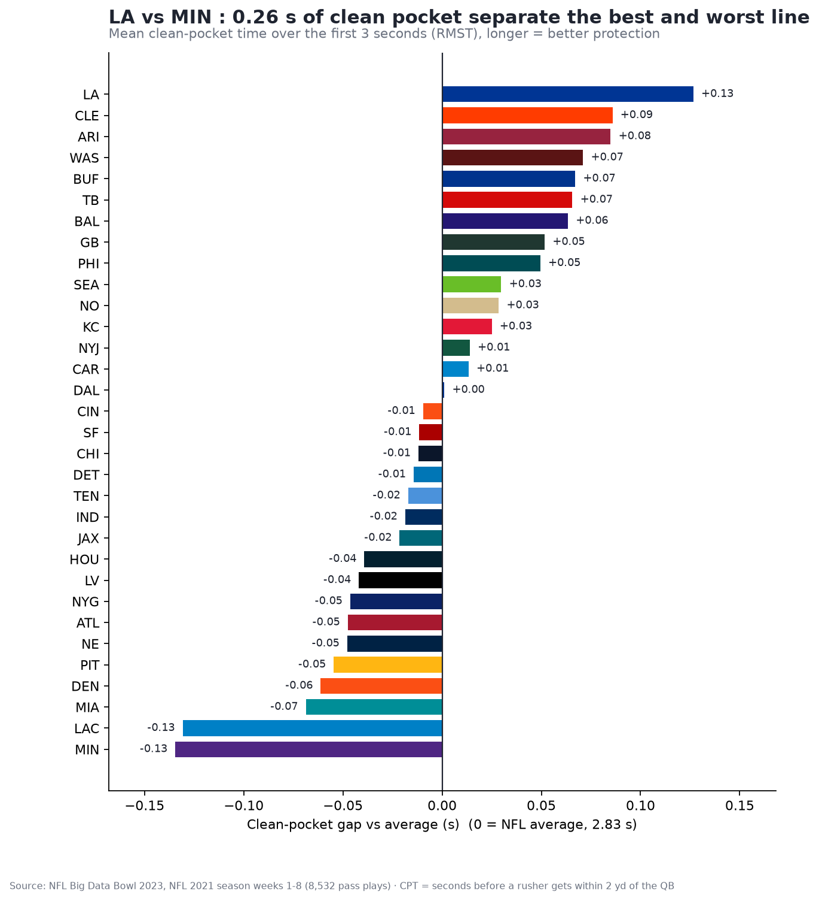
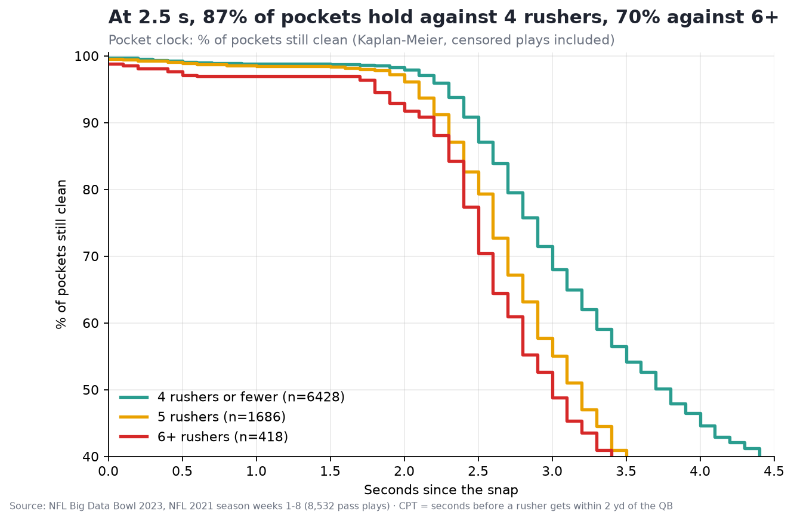

# ⏱️ Pocket Clock — how much time does the QB really have?

Nous avons inventé le **Clean Pocket Time (CPT)** : le nombre de secondes entre le snap et le moment où un pass rusher arrive à moins de 2 yards du QB. Il est calculé directement depuis le tracking des 8 532 passes de la saison NFL 2021 (semaines 1-8). Les actions où personne n'arrive sont traitées comme « censurées » (Kaplan-Meier) au lieu d'être jetées.

**Quelques résultats :**
- Sur les 3 premières secondes, les poches des **Rams** restent propres 2,95 s en moyenne, contre 2,69 s pour celles des **Vikings**.
- À 2,5 s, **87 %** des poches tiennent contre 4 rushers, mais seulement **70 %** contre 6 rushers ou plus.
- **Trey Hendrickson** atteint le QB sur 24 % de ses rushs, le meilleur taux de la NFL.

**À qui ça sert :**
- **Coach offensif** : voir où sa ligne craque, avec les bloqueurs les plus souvent battus.
- **Coach défensif** : savoir quel rusher atteint le QB le plus souvent.
- **Recruteur** : comparer les bloqueurs et les rushers sur une mesure objective.
- **Commentateur** : afficher l'« horloge de la poche » à l'antenne.




---

## Démarrage rapide

Il faut Python ≥ 3.10 et NumPy ≥ 2 (le code utilise `np.trapezoid`).

```bash
python -m venv .venv && .venv/bin/pip install -r requirements.txt
.venv/bin/python run_all.py              # pipeline complet : chargement → CPT → validation → figures
.venv/bin/streamlit run app.py           # dashboard interactif
.venv/bin/python -m src.export_html      # dashboard HTML autonome → outputs/pocket_clock_dashboard.html
```

| Commande | Rôle | Durée |
|---|---|---|
| `python run_all.py` | Calcule tout et écrit `cache/` et `outputs/` | ~3 min la 1re fois, puis quelques secondes (cache parquet) |
| `DEBUG=1 python run_all.py` | Même chose sur 5 matchs seulement, pour tester | quelques secondes |
| `streamlit run app.py` | Dashboard : équipe, bloqueurs, rushers, rejeu d'action | demande d'avoir lancé `run_all.py` une fois |
| `python -m src.export_html` | Export HTML sans serveur (classement, courbes, 3 rejeux) | demande `cache/cpt_table.parquet` |
| `python -m src.load` / `python -m src.metrics` | Lance une seule étape et affiche son résumé | — |

Le notebook [notebooks/analysis.ipynb](notebooks/analysis.ipynb) reprend toute l'analyse (Restart & Run All fonctionne avec le kernel du venv). Il est généré par [make_notebook.py](make_notebook.py), qui demande `nbformat` (non listé dans `requirements.txt`).

## Données

Ce sont les données du Big Data Bowl 2023 (saison **2021**, semaines 1-8, 122 matchs). Elles doivent être placées dans `data/` :

```
data/
├── games.csv  plays.csv  players.csv  pffScoutingData.csv
└── tracking/tracking_<gameId>.csv     # un fichier par match, 10 images/s
```

Les données brutes ne sont pas versionnées (~830 Mo). Voir [README_original_dataset.md](README_original_dataset.md).

## Structure du projet

```
├── run_all.py            # point d'entrée du pipeline
├── app.py                # dashboard Streamlit
├── make_notebook.py      # génère notebooks/analysis.ipynb
├── src/
│   ├── load.py           # lecture CSV, normalisation du sens du jeu, fenêtre snap→fin, cache parquet
│   ├── metrics.py        # distances QB-rushers, CPT par action, table des duels rusher↔bloqueur
│   ├── analysis.py       # Kaplan-Meier, RMST, classements, CPT attendu (Cox)
│   ├── validate.py       # contrôles de cohérence football et accord avec PFF
│   ├── viz.py            # figures PNG et GIF animé
│   ├── replay.py         # rejeu Plotly d'une action
│   └── export_html.py    # dashboard HTML autonome
├── cache/                # parquet intermédiaires (générés)
├── outputs/              # figures, CSV de classements et de validation (générés)
└── docs/                 # documentation détaillée
```

## Documentation

- [docs/methodologie.md](docs/methodologie.md) : définition du CPT, censure, RMST, modèle attendu, validation et limites.
- [docs/architecture.md](docs/architecture.md) : flux de données, rôle de chaque module, fonctions principales et paramètres.
- [docs/sorties.md](docs/sorties.md) : description de chaque fichier de `outputs/` et `cache/`, colonne par colonne.

## Méthode en bref

- Le **CPT** vaut (1re frame où la distance QB-rusher passe sous 2 yd − frame du snap) / 10. Si aucun rusher n'arrive, CPT = durée observée et `censored = True`.
- Les équipes sont classées par **RMST**, le temps moyen de poche propre sur 3 s, c'est-à-dire l'aire sous la courbe de Kaplan-Meier.
- Le **CPT attendu** est estimé par une régression de Cox sur le contexte. La différence réel − attendu donne la valeur ajoutée de la ligne, indépendamment du schéma.
- **Validation** : les sacks ont la poche la plus courte (2,63 s contre 2,86 s sur les passes complètes). L'accord avec les pressions PFF est de φ = 0,61.

Le détail est dans [docs/methodologie.md](docs/methodologie.md).

## Limites

- **Petit échantillon** : 8 semaines, soit ~250 actions par équipe. Les écarts entre équipes (≤ 0,26 s) sont des tendances.
- **Seuil arbitraire** : le rayon de 2 yd est un choix. Les classements n'y sont que moyennement stables (Spearman 0,73 entre 1,5 et 2 yd, 0,45 entre 2 et 3 yd).
- **Beaucoup de censure** : 68 % des actions sont censurées, et cette censure est informative (un QB rapide « cache » sa ligne). Les courbes sont peu fiables au-delà de ~3 s.
- **Ce que la distance ne voit pas** : la qualité du bloc, la lecture du QB et la pression « mentale ». De plus, le tracking s'arrête au lancer.
