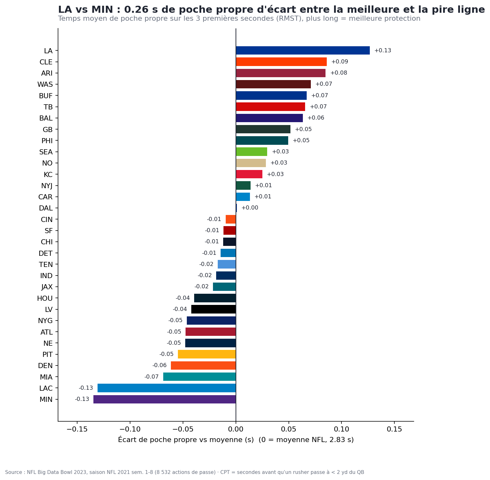
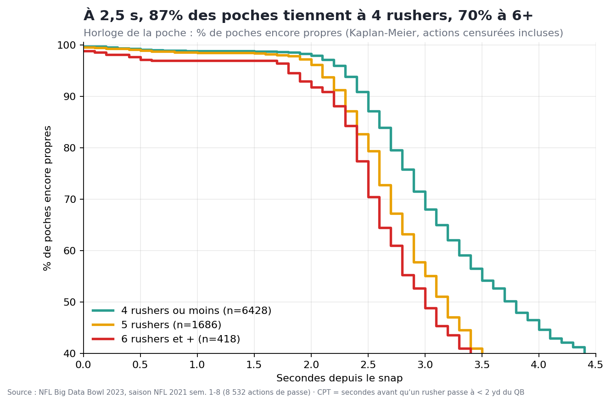

# ⏱️ Pocket Clock — combien de temps le QB a-t-il vraiment ?

Nous avons inventé le **Clean Pocket Time (CPT)** : le nombre de secondes entre le snap et le moment où un pass rusher arrive à moins de 2 yards du QB, calculé directement depuis le tracking des 8 532 passes de la saison NFL 2021 (semaines 1-8), avec les actions où personne n'arrive traitées en « censurées » (Kaplan-Meier) plutôt que jetées. Sur 3 secondes, les poches des Rams restent propres 2,95 s en moyenne, celles des Vikings 2,69 s ; à 2,5 s, 87 % des poches tiennent contre 4 rushers mais seulement 70 % contre 6 et plus. Un coach offensif y voit où sa ligne craque (bloqueurs les plus battus), un coach défensif quel rusher atteint le QB le plus souvent (Hendrickson : 24 % de ses rushs), un recruteur compare les bloqueurs, et un commentateur affiche l'« horloge de la poche » à l'antenne.




## Comment lancer
```bash
python -m venv .venv && .venv/bin/pip install -r requirements.txt
.venv/bin/python run_all.py                    # pipeline complet (~3 min la 1re fois, ensuite cache parquet) ; DEBUG=1 pour 5 matchs
.venv/bin/streamlit run app.py                 # dashboard interactif (équipe, bloqueurs, rushers, rejeu d'action)
.venv/bin/python -m src.export_html            # version HTML autonome : outputs/pocket_clock_dashboard.html
```
Notebook : `notebooks/analysis.ipynb` (Restart & Run All OK, kernel du venv). Images/GIF dans `outputs/`.

## Méthode
- Données : Big Data Bowl 2023 (saison **2021**, sem. 1-8, 122 matchs). Tracking à 10 images/s ; le temps vient de `frameId`, pas de `time`. Sens du jeu normalisé (attaque vers la droite).
- Fenêtre : du snap (`ball_snap`/`autoevent_ballsnap`) au lancer, sack ou dernière frame. QB = `pff_role == "Pass"`, rushers = `"Pass Rush"`.
- **CPT** = (1re frame avec distance QB-rusher < `PRESSURE_RADIUS` − frame du snap) / 10. Sans rusher arrivé : CPT = durée observée, `censored = True`.
- Classements d'équipes : **RMST** (temps moyen de poche propre sur 3 s = aire sous la courbe de Kaplan-Meier), qui gère les actions censurées.
- **CPT attendu** : régression de Cox (nb de rushers, play action, down, distance, formation, couverture) ; « au-dessus de l'attendu » = valeur ajoutée de la ligne indépendante du schéma.
- Duels : `pff_nflIdBlockedPlayer` relie chaque rusher à son bloqueur assigné (classement des bloqueurs battus, vitesse d'entrée des rushers).
- Validation : sacks = poche la plus courte (RMST 2,63 s contre 2,86 s sur passes complètes) ; plus de rushers = poche plus courte ; accord avec les pressions PFF (hit/hurry/sack) : φ = 0,61, 81 % de nos pressions sont aussi des pressions PFF et nous en captons 69 %.

## Limites (honnêteté méthodologique)
- 8 semaines seulement : ~250 actions par équipe, donc les écarts entre équipes (≤ 0,26 s) sont à lire comme des tendances, pas des vérités.
- Le seuil de 2 yd est arbitraire et les classements n'en sont que moyennement stables (corrélation de Spearman 0,73 entre 1,5 et 2 yd, 0,45 entre 2 et 3 yd).
- 68 % des actions sont censurées (le QB lance avant la pression) : la censure est informative (un QB rapide « cache » sa ligne), et les courbes sont peu fiables au-delà de ~3 s.
- La distance ne capte ni la qualité du bloc, ni la lecture du QB, ni les pressions « mentales » ; le tracking s'arrête au lancer.
- Le play action ne montre pas de poche plus longue en RMST, mais allonge le temps avant lancer (3,3 s contre 2,7 s) : les deux effets sont mélangés.
